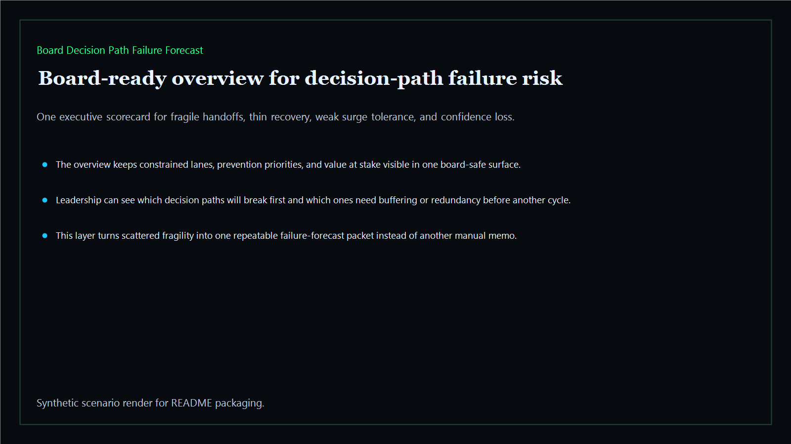
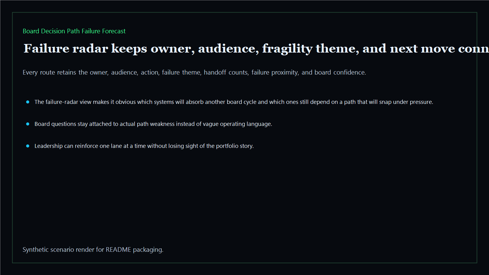
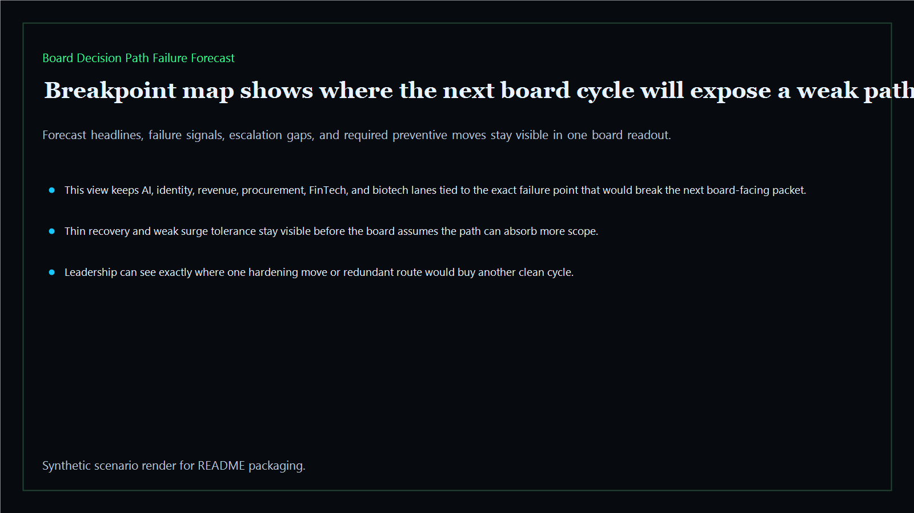
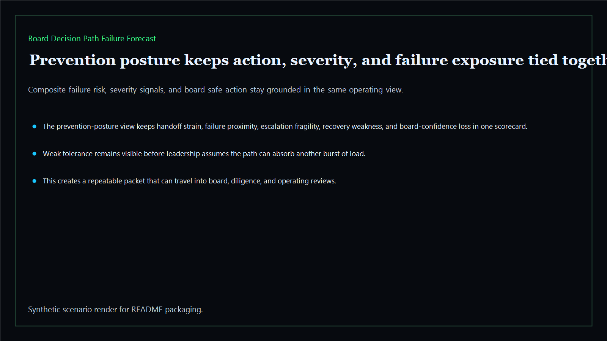

# Board Decision Path Failure Forecast

Board-ready failure-forecast surface for predicting which decision paths will break first, where the next cycle will stall, and what boards should reinforce before the damage compounds.

- Live: `http://failure.kineticgain.com/`
- Repo: `mizcausevic-dev/board-decision-path-failure-forecast`

## Why this matters

Leaders need one board-readable forecast layer that shows which decision paths will fail first, where the next cycle will stall, and which preventive move belongs in the packet before the damage compounds.

## What it includes

- TypeScript executive-intelligence surface for board-facing path-failure forecasting with modeled executive lanes, breakage thresholds, and board-safe prevention posture
- synthetic executive lanes across AI, identity, revenue, FinTech, biotech, procurement, and public-sector readiness
- reusable outputs for failure radar, breakpoint maps, prevention posture, and board-ready operating memos
- prerendered static site, JSON payloads, screenshots, and docs

## Routes

- `/`
- `/failure-radar`
- `/breakpoint-map`
- `/prevention-posture`
- `/verification`
- `/docs`

## Local run

```bash
cd board-decision-path-failure-forecast
npm install
npm run verify
npm run prerender
npm run render:assets
```

## CLI

```bash
npx board-decision-path-failure-forecast fixtures/board-decision-path-failure-forecast.json --format summary
npx board-decision-path-failure-forecast fixtures/board-decision-path-failure-forecast-clean.json --format json
```

## Docs

- [Architecture](docs/architecture.md)
- [Origin](docs/ORIGIN.md)
- [Kinetic Gain Embedded](docs/KINETIC_GAIN_EMBEDDED.md)

## Screenshots





